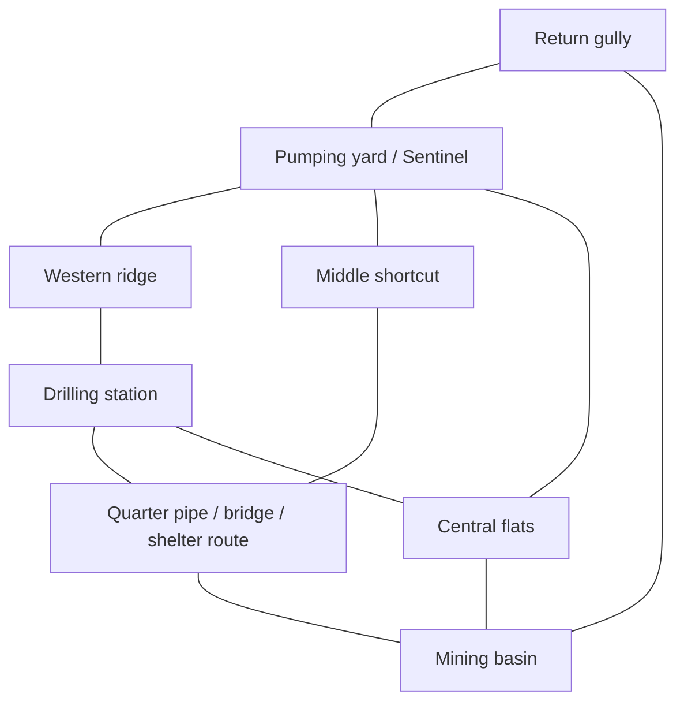

# Canyon map audit — first pass

November 14, 2026. **Source/layout audit and proposal; no map edits yet.**

## Finding

The strongest evidence is a mismatch between space and purposeful content, especially in the central flats. The whole map may also be too large, but a source audit alone cannot settle how traversal feels during a run. Preserve its connected adventure structure while improving a representative portion, then decide which distances earn their place.

Do not expand the footprint. Do not fill every open surface with obstacles. Keep space for six players, swarms, charges, and long movement lines.

## Evidence and confidence

Inspected `CanyonLayout.cs`, `CanyonCenterSetup.cs`, `CanyonJourneySetup.cs`, `CanyonLoopSetup.cs`, relevant station construction, the saved scene's named objects, and historical overview/yard images. The saved scene contains the central flats, shelf/terrace objects, yard, and boss console.

The existing `loop-overview.png` predates the central flats and shows an empty center: it is historical context, not a current overview. No fresh in-game route timing, collision test, or performance capture was performed for this audit.

Distances below are source centerline lengths, including height differences. Times assume a constant 11 m/s (the default run speed), with no acceleration, fighting, detours, collision, or movement tricks. They are estimates, not observed playtest results. Individual scene overrides can also affect actual speed.

| Space/connection | Source measurement | Implication |
|---|---|---|
| Central flats | About **74,735 m²**, 590 m north–south extent, up to 188 m wide | A very large shared space with relatively few authored feature clusters. Its outer extent includes narrow ends, not a rectangular arena. |
| Pumping yard | Main floor 92 × 104 m, about **9,568 m²** | Already a substantial arena. Central flats floor area is about 7.8 times larger. |
| Basin exit → station approach | About **609 m / 55 s** along JourneyPoints | Existing bridge, quarter pipe, bank, ledges, and shelter provide identity, but the full journey needs several meaningful beats. Endpoints exclude some internal POI travel. |
| Station → pumping yard | About **381 m / 35 s** along the ridge centerline | An optional high-speed line exists, but long connecting sections need a reason to choose them. |
| Pumping yard → basin | About **420 m / 38 s** along the return gully | Strongest outer-route candidate for compression if it remains mostly transit. |
| Shelter → pumping yard | About **224 m / 20 s** along the middle route | Useful alternative to the perimeter. Its role should stay distinct from crossing the flats. |

The three main outer route centerlines total about 1.41 km, excluding traversal across their destination POIs. At constant run speed that is about 128 seconds of travel. This is not automatically too long for a 10-minute area: meaningful choices, encounters, shortcut value, and actual player speed determine its usefulness.

## Connectivity to preserve

Conceptual connectivity, not a measured navigation graph:

## Recommendations by region

| Region | Keep | Proposed change | Avoid |
|---|---|---|---|
| Mining basin | Compact movement playground, hoist chains, upper/lower routes and starting orientation | Make exits and the first visible goal clearer. Add only features that improve an existing route or encounter. | Enlarging it or burying practiced movement lines in decoration. |
| Central flats | Shallow dip, cross-map freedom, broad combat lanes, shelf and terrace | Author three recognizable clusters connected by clear travel lines; concentrate content instead of distributing isolated props across the entire floor. | A deep bowl, maze, or uninterrupted wall across the middle. |
| Eastern passage | Quarter pipe, bridge/gully choice, bank, zip/ledge chains, shelter | Evaluate the lengths between existing beats. Rework or shorten low-value approaches while preserving speed/landing room. | Shortening the bridge just because its approaches are empty; player previously wanted a substantial journey. |
| Drilling station | Drill risk, bowl crossing, rim alternative, escape zip, elevated slide return | Strengthen approaches and readable connections between its existing activities. | More random hazards or clutter in the drill's readable danger space. |
| Pumping yard | Relay landmark, walking ascent, return slide, console, open boss floor | Arrange a small amount of perimeter equipment/cover to support combat and movement; keep boss approach and attack lanes readable. | Filling the Sentinel arena before testing its charge and shockwave space. |
| Western ridge | Height change, optional zip, outer-route alternative | Give retained stretches a clear view, movement decision, or useful reward detour. Compress repeated transit if it provides none. | Adding another long branch or unrelated POI. |
| Return gully | Connection back to basin and recoverable ordinary route | Review as the first route to shorten if measured play remains empty. Prefer selective edits over globally scaling the map. | Global coordinate scaling, which would alter jump gaps, bowl shape, speed relationships, and collider clearances. |

## First implementation proposal: central flats

Start here because it addresses the player's empty-space concern while preserving the approved perimeter and existing movement tests.

1. **South crossing:** around the existing southern rocks near x=-150, z=220–260, create a coherent low equipment/rock cluster. A broad sloped approach should support sliding past/through it; offset cover offers a bounce option without sealing the lane.
2. **Middle junction:** around x=-160, z=340–380, make the meeting of yard/shelter/central routes recognizable. Use a few large forms and a traversable raised edge, with several wide exits and a clear view toward destinations. This is a route decision space, not a new gated objective.
3. **North shelf/cache:** improve the existing shelf/zip and cache region near x=-100, z=440–500. Connect the landing, combat floor, and return slide so movement has an intentional loop and the reward has a readable approach.

All positions and dimensions are proposals, not final placements. Check local floor heights and path clearance before implementation. Reuse existing rocks/materials and objectives rather than creating new systems. No new mandatory combat lock, currency sink, or safe zone is implied.

Leave the remaining open areas in place for this first comparison. If players still spend long periods simply holding forward, shorten identified empty stretches or bring existing activities closer; do not commit to filling the entire 75,000 m².

## Playtest and acceptance plan

- Capture a current overview before changes, since the historical overview is stale.
- Record a no-combat baseline: basin → south flats → middle junction → yard, then yard → north shelf → station. Repeat in the opposite direction.
- Compare ordinary movement and skilled traversal: travel time, moments of decision, recognizable destinations, recoverable misses, and unwanted stops.
- Test with combat: enemies reach players at all clusters and transitions; cover does not create unreachable farms; warnings and movement lanes remain readable.
- Preserve ordinary walking alternatives, the accepted quarter-pipe fall-off exception, zip exits, bridge/gully choices, and the drill escape routes.
- Compare solo and host/client; distinguish a two-instance check from six-human usability.
- Measure CPU/GPU frame time, spikes, navigation update cost, collider/renderer changes, and memory before/after under comparable conditions. Specific targets await the agreed minimum PC; avoid promising performance from object counts alone.
- Ask the player whether each cluster adds worthwhile movement/combat and whether the trip still feels too long. Record keep/rework/shrink decisions before expanding the pass.

## Implementation ownership and dependencies

One owner should edit shared scene generation and the saved scene. Main edit candidates: `Assets/Editor/CanyonCenterSetup.cs` and `Assets/Scenes/CanyonPlayground.unity`; coordinate any changes to `CanyonLayout.cs`, navmesh/spawn bounds, and smoke probes. Existing editor setup calls regenerate regions, so hand edits alone are not a durable implementation.

Source control/baseline remains a prerequisite to a multi-agent map batch. No agents were started for this audit. Timer, economy, menus, and Charger production are separate backlog work; the 10-minute area deadline is design context, not a newly tested runtime feature.
